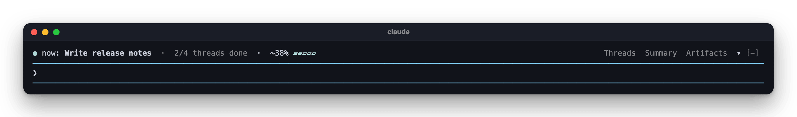
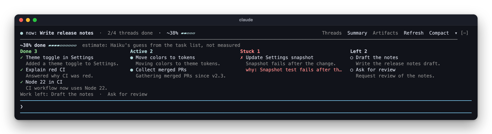
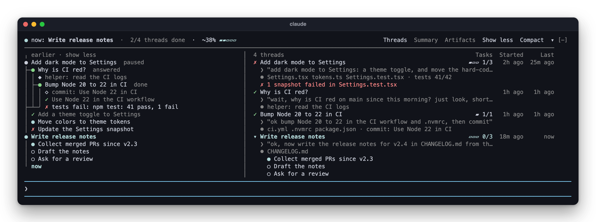

<div align="center">

# whatcha-doing

A band above the Claude Code prompt that shows what you asked each session and what it actually did.

[](https://github.com/surajmandalcell/claude-whatcha-doing)
[](.claude-plugin/plugin.json)
[](LICENSE)

</div>


## Why

You keep many Claude Code tabs open, and they often do similar jobs. After a while you cannot tell which tab
is which. whatcha-doing shows, at a glance, what you asked each session, what it did, and what failed.

## Features

| | |
|---|---|
|  |  |
| **Status row.** By default the band is one row: the thread you are on now, how many threads are done, and an estimate. | **Summary.** One Haiku call sorts the tasks into Done, Active, Stuck and Left, each with a one-line note. |
|  |  |
| **Artifacts.** The pages this project published, newest change first. A click on the name copies the link; the link opens on click. | **Minimized.** `▾` shrinks the band to `▴ @whatcha-doing` on the right. |
|  | |
| **Show all.** A long list ends in "+N more". A click grows the band to show everything; `Show less` goes back. | |

**Threads** (the shot at the top) puts a timeline beside a table of every thread. Each prompt opens a thread.
A new prompt after work started is a side trip, shown under the thread it came from. Each thread shows your last
prompt (`❯`), what it did (`⏺`: files, tests, commits) and its last failure (`✗`).

## Install

At the prompt of a Claude Code terminal session:

```
/plugin install whatcha-doing --marketplace surajmandalcell/claude-whatcha-doing
```

Answer `y` to add the marketplace, then pick a scope (user scope loads it in every session). The band shows at once.

From a shell:

```sh
claude plugin install whatcha-doing --marketplace surajmandalcell/claude-whatcha-doing
```

For development, load it from a clone. For one session:

```sh
claude --plugin-dir /path/to/claude-whatcha-doing
```

For every session, add the folder to the `env` block of `~/.claude/settings.json`. Saving a file then reloads the mod:

```json
"CLAUDE_CODE_PLUGIN_DIRS": "/path/to/claude-whatcha-doing"
```

## Usage

The band is driven with the mouse: click the tabs and buttons. Keys still go to the prompt.

| Command | What it does |
|---|---|
| `/whatcha open` or `/whatcha threads` | Open the Threads tab |
| `/whatcha summary` | Open the Summary tab |
| `/whatcha artifacts` | Open the Artifacts tab |
| `/whatcha all` | Show everything, no height limit |
| `/whatcha close` | Back to the one status row |
| `/whatcha min` | Shrink to `▴ @whatcha-doing` |
| `/whatcha demo`, `/whatcha live` | Show sample data, or go back to this session |

The open band takes up to 30% of the rows on a terminal of 40 rows or more. Set `WHATCHA_DEMO=1` to start in demo mode.

## Haiku budget

Only the Summary tab calls a model. It runs only when you open Summary or click Refresh, never on its own.
One call is at most 600 tokens in and 250 tokens out, and the answer is cached until the session changes.
Everything else is built from hooks alone, with no model call.

## Privacy

The Summary call sends a short digest: thread titles and task names (each cut to 40 characters), their states,
file and commit counts, and the last test and error line. Nothing from the transcript is sent: no full prompts,
no replies, no file contents. The Artifacts list is kept in the mod's local store, one
list per project folder. Nothing leaves your machine except that one Haiku call.

## Develop

```sh
claude plugin validate .
claude plugin test .
```

The design notes are in [specs/design.md](specs/design.md).

## License

[MIT](LICENSE)
