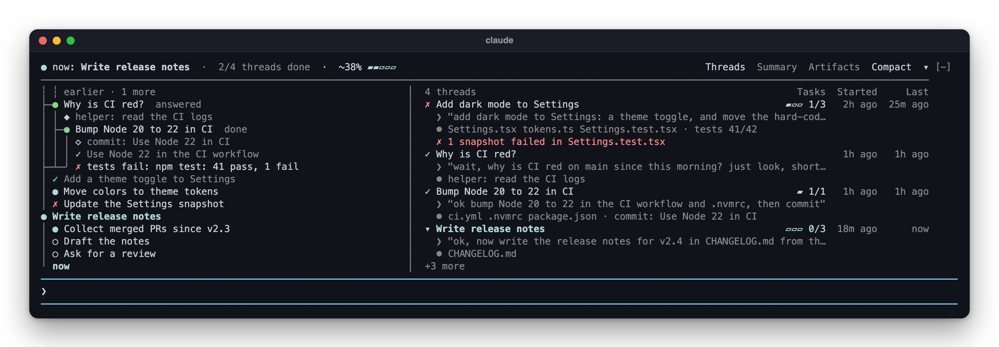
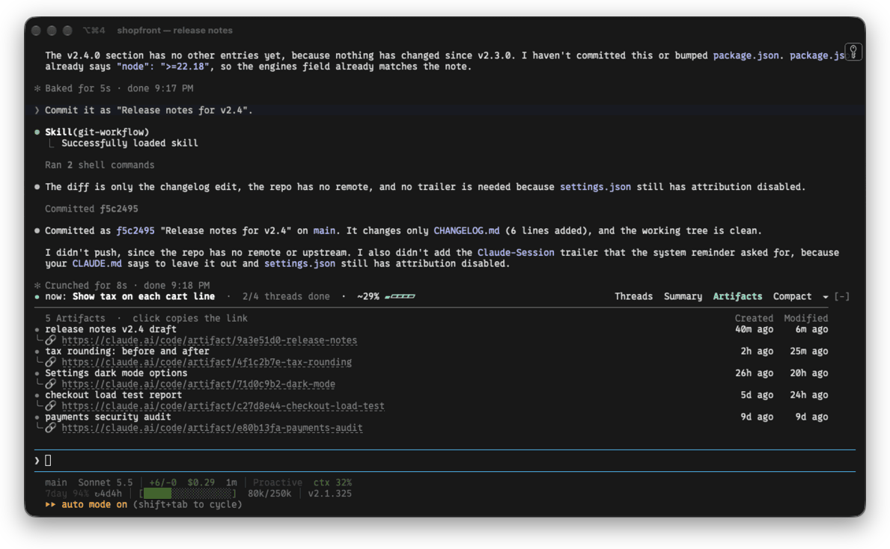

<p align="center">
  
</p>

<p align="center">
  <b>See what each Claude Code tab is doing. Right above the prompt.</b><br>
  Your prompts, Claude's tasks, and what passed or failed, in one band.
</p>

<p align="center">
  <a href="#install"><b>Install</b></a> &nbsp;·&nbsp;
  <a href="#how-to-use">How to use</a> &nbsp;·&nbsp;
  <a href="https://github.com/surajmandalcell/claude-whatcha-doing/issues">Report a problem</a>
</p>

<p align="center">
  <a href="https://github.com/surajmandalcell/claude-whatcha-doing"></a>
  <a href=".claude-plugin/plugin.json"></a>
  <a href="LICENSE"></a>
</p>

## Why whatcha-doing

You keep many Claude Code tabs open, and they often do similar jobs. After a while you cannot tell which tab is which.

- **One look.** The band names what you asked this tab and what it did.
- **Your words.** Rows use your prompts, file names, test counts and errors, not generic labels.
- **Out of the way.** One status row by default. Hide it with `▾`.
- **Cheap.** No model runs unless you open Summary.

## Features

| | |
| --- | --- |
| **Threads** | A timeline of your prompts, grouped into threads. Under each one: Claude's tasks, plan steps and recent work. Newest at the bottom. Columns show the time you sent it, commits, files and tests (`11 pass · 1 fail`). |
| **Summary** | Haiku's estimate of how far along the work is, as Done, Active, Stuck and Left. |
| **Artifacts** | Every page this project published, newest first. Click a name to copy its link. |
| **Thread names** | On a Mac with Apple Intelligence, the on-device model names each thread in 3 to 6 words. |

| Status row | Summary | Artifacts |
| :---: | :---: | :---: |
|  |  |  |

## Install

At the prompt of a Claude Code session:

```
/plugin install whatcha-doing --marketplace surajmandalcell/claude-whatcha-doing
```

Answer `y` to add the marketplace, then pick a scope. User scope loads it in every session. The band shows at once.

<details>
<summary>From a shell, and auto-update</summary>

<br>

```sh
claude plugin install whatcha-doing --marketplace surajmandalcell/claude-whatcha-doing
```

To get new versions on start, run `/plugin`, open Marketplaces, pick `claude-whatcha-doing`, and turn on auto-update. To update by hand:

```sh
claude plugin marketplace update claude-whatcha-doing
claude plugin update whatcha-doing@claude-whatcha-doing
```

</details>

## How to use

Click the tabs and buttons in the band. Your keys still go to the prompt.

| Size | What it shows |
| --- | --- |
| **S** | One status row: `▸ Now (2/4): <your last prompt>` |
| **M** | 5 rows of the open tab |
| **L** | Up to 22 rows, or 20% of the screen |
| **▾** | Hides the band to `▴ @whatcha-doing` |

In M and L, `▲ ▼` scroll the Threads timeline a page, and `⤒ ⤓` jump to the oldest or newest row. The mouse wheel works too.

<details>
<summary>Slash commands</summary>

<br>

| Command | What it does |
| --- | --- |
| `/whatcha threads` | Open Threads |
| `/whatcha summary` | Open Summary |
| `/whatcha artifacts` | Open Artifacts |
| `/whatcha compact` | Size M |
| `/whatcha close` | Size S |
| `/whatcha min` | Hide the band |
| `/whatcha all` | Show every row, no height limit |
| `/whatcha demo`, `/whatcha live` | Show sample data, or go back to this session |

Set `WHATCHA_DEMO=1` to start in demo mode.

</details>

## How it works

- **Hooks, no model.** Threads and Artifacts are built from Claude Code's own events. Loaded mid-session, the band rebuilds the threads from the transcript.
- **Haiku runs only on Summary.** It runs when you open that tab or click ↻, never on its own. One call is at most 600 tokens in and 250 out, and the answer is cached until the session changes.
- **Haiku sees a short digest.** Thread and task names (cut to 40 characters), their states, file and commit counts, and the last test and error line. No full prompts, replies or file contents.
- **Thread names stay on your Mac.** Apple's on-device model writes them. Nothing is sent.
- **Artifacts stay local.** The list is kept in the mod's local store, one list per project folder.

## Develop

```sh
claude --plugin-dir /path/to/claude-whatcha-doing   # load a clone for one session
claude plugin validate . && claude plugin test .
zsh scripts/release.zsh                              # checks, bumps the version, commits and pushes
```

Installed copies update only when the version in `.claude-plugin/plugin.json` changes. Design notes are in [specs/design.md](specs/design.md).

## License

[MIT](LICENSE)
